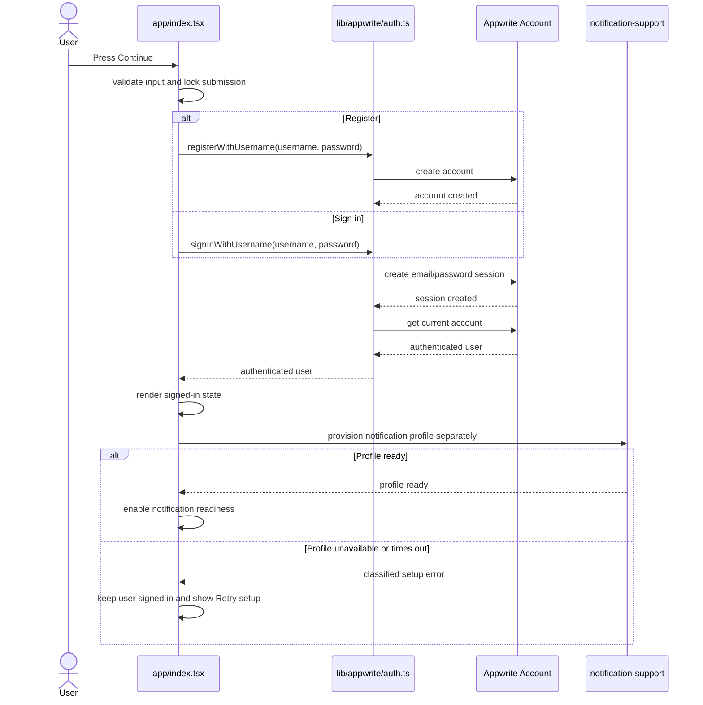

# Junior Developer Checklist: Fix Registration and Sign-In Hanging

## Purpose

Use this checklist to fix the authentication screen that remains on the loading spinner while registration or sign-in waits inside `lib/appwrite/auth.ts`.

The important design rule is that **Appwrite authentication and notification-profile setup are separate operations**. A user is authenticated when Appwrite creates a session and `account.get()` returns the account. A slow or unavailable `notification-support` Function must not make valid credentials look invalid or delete a valid session.

This checklist was prepared using the Appwrite implementation in `C:\Users\ricky\REPOS\myapp` as the required reference. In particular:

- `myapp/app/(auth)/sign-in.jsx` and `sign-up.jsx` disable repeated submissions while a request is active.
- `myapp/utils/validation.js` validates passwords with an eight-character minimum.
- `myapp/utils/errorHandler.js` maps Appwrite errors to safe, operation-specific messages.
- `myapp/lib/sessionManager.js` centralizes current-session operations and distinguishes an absent session from other work.
- `myapp/app/(auth)/sign-up.jsx` documents push setup as non-fatal to account creation.

Do not copy `myapp` blindly. Match this repository's TypeScript style, username-based login contract, tests, and two-Function notification architecture.

## Desired authentication flow



## Contract to preserve

`registerWithUsername()` owns account creation and automatic sign-in. `signInWithUsername()` owns session creation and account retrieval. Both return an authenticated `AuthUser` only after `account.get()` succeeds.

`ensureNotificationProfile()` owns notification-profile provisioning. Its failure may disable notification actions, but it must not turn successful authentication into an authentication failure.

The UI owns submission locking, progress text, safe error messages, and the separate notification-profile setup state. It must never automatically retry mutating account or session requests after an uncertain timeout.

## Phase 1: Capture the exact pending stage

- [ ] **Debugging:** Reproduce one registration attempt and one sign-in attempt.
- [ ] Record the last authentication log before the spinner stops progressing.
- [ ] Classify the pending stage using this map:
  - `registerWithUsername email derived` means `account.create()` has not returned.
  - `Account created, signing in...` means session creation has not returned.
  - `signInWithUsername session created` means account retrieval or local receipt state has not returned.
  - `signInWithUsername ensuring app user document` or `Calling ensureProfile function` means the synchronous support Function has not returned.
- [ ] In Appwrite Console, check whether the attempt created an Auth user, a session, and a `notification-support` execution. Record facts; do not delete records simply to make the next attempt pass.
- [ ] Save sanitized timestamps, HTTP/Appwrite error types, and execution IDs. Do not record passwords, session secrets, API keys, FCM tokens, or complete private response bodies.

**Evidence required:** the last mobile log, whether the Auth user exists, whether a session exists, and whether an `ensureProfile` execution exists.

## Phase 2: Prevent duplicate submissions

File: `app/index.tsx`

- [x] **Frontend:** Add `authLoading` to the Continue button's `disabled` condition.
- [x] Add an early return at the beginning of `submitAuth()` when `authLoading` is already true.
- [x] Keep the loading flag reset in `finally`.
- [x] Add a visible progress label such as `Creating account`, `Signing in`, or `Preparing notifications`; do not rely on one unexplained spinner.
- [x] Verify that repeated taps produce exactly one Appwrite request chain.

Reference behavior: `myapp/app/(auth)/sign-in.jsx` and `sign-up.jsx` disable their buttons with `isSubmitting` and reset that state in `finally`.

**Acceptance check:** ten rapid taps result in one account-creation attempt or one session-creation attempt.

## Phase 3: Separate authentication from profile provisioning

Files: `lib/appwrite/auth.ts`, `lib/appwrite/users.ts`, `lib/appwrite/notifications.ts`, and `app/index.tsx`

- [x] **Frontend/Auth:** Remove `ensureAppUserDocument()` from the success-critical portion of `signInWithUsername()`.
- [x] Return the authenticated user immediately after session creation, `account.get()`, and required local receipt-user bookkeeping.
- [x] Do not call `account.deleteSession('current')` merely because notification-profile provisioning failed.
- [x] Start notification-profile provisioning only after the UI has stored the authenticated user.
- [x] Give profile provisioning its own state: `idle`, `loading`, `ready`, or `error`.
- [x] Disable notification actions while the profile state is not `ready`, without hiding or signing out the authenticated user.
- [x] Provide a `Retry notification setup` action for transient Function, configuration, or database failures.
- [x] Keep profile creation idempotent so retrying cannot create duplicate user documents.

Reference behavior: `myapp` treats the Auth session as a distinct concern through its `signIn()` and session-management functions. Its sign-up screen also labels push setup as non-fatal. Preserve that separation more strictly here because this project currently waits for a synchronous Appwrite Function.

**Acceptance check:** force `ensureNotificationProfile()` to reject. The user must remain signed in, the auth spinner must stop, and notification readiness must show a retryable setup error.

## Phase 4: Handle partial registration explicitly

Files: `lib/appwrite/auth.ts` and `app/index.tsx`

- [x] **Frontend/Auth:** Track whether `account.create()` completed before a later step failed.
- [x] If the account was created but automatic sign-in failed, show: `Your account was created, but automatic sign-in did not finish. Try signing in.`
- [x] Switch the UI to sign-in mode instead of inviting the user to register the same username again.
- [x] Do not automatically repeat `account.create()` after a timeout or uncertain transport result.
- [x] Before recommending another registration attempt, reconcile state safely through sign-in or an Appwrite Console check.
- [x] Preserve the normalized username-to-email mapping so registration and sign-in derive the same synthetic email.

**Acceptance check:** mock successful account creation followed by failed session creation. The UI reports partial success and a later sign-in can recover the account.

## Phase 5: Add bounded waits without unsafe retries

Files: `lib/appwrite/auth.ts` and `lib/appwrite/notifications.ts`

- [x] **Debugging/Frontend:** Define named deadlines for user-facing waits rather than leaving the spinner active indefinitely.
- [x] Classify a deadline as an uncertain result, not proof that the Appwrite request failed.
- [x] Do not blindly retry `account.create()` or `createEmailPasswordSession()`; the first request may complete after the UI deadline.
- [x] After an uncertain session result, attempt a safe `account.get()` reconciliation before telling the user to retry.
- [x] A notification-profile deadline may expose a Retry button because profile provisioning must be idempotent.
- [x] Ensure timers are cleared when operations settle and do not update React state after the screen unmounts.

**Acceptance check:** use a never-resolving mock. The UI exits the loading state within the documented deadline and does not send a second mutating request automatically.

## Phase 6: Improve validation and safe errors

Files: `app/index.tsx` and, if justified by reuse, a small existing-or-new validation/error utility

- [x] **Frontend:** Require at least eight password characters before registration.
- [x] Keep sign-in validation compatible with accounts created under the active Appwrite password policy.
- [x] Preserve the existing username pattern and normalization rules.
- [x] Map common Appwrite outcomes into safe categories: invalid credentials, account already exists, rate limited, network unavailable, configuration/platform failure, and notification-profile setup failure.
- [x] Preserve Appwrite `code`, `type`, operation name, and stage in development logs without logging passwords or session data.
- [x] Replace the current generic message that always blames configuration, username, or password.

Reference behavior: `myapp/utils/validation.js` uses an eight-character minimum, while `myapp/utils/errorHandler.js` separates safe display text from diagnostic logging.

**Acceptance check:** each error category produces distinct safe UI text and retains useful development diagnostics.

## Phase 7: Verify the Appwrite client and Console configuration

Files: `lib/appwrite/client.ts`, `index.js`, `package.json`, `.env.example`, and Appwrite Console

- [x] **Backend/Configuration:** Confirm the runtime endpoint, project ID, and database ID are non-empty without printing their values.
- [x] Confirm `setPlatform()` receives exactly `com.pushnotificationexample.app`.
- [ ] Confirm an Android platform with exactly that package name exists in the same Appwrite project.
- [ ] Confirm email/password authentication is enabled.
- [ ] Confirm the active password policy matches the client-side registration guidance.
- [ ] Confirm `notification-support` has an active deployment.
- [ ] Confirm signed-in users have execute access to `notification-support`.
- [ ] Confirm its Appwrite environment variables and database/user scopes are present. Never copy server secrets into Expo public variables.
- [x] Compare the installed React Native Appwrite setup with `myapp/lib/appwrite.js`, which explicitly configures endpoint, project, and platform.
- [x] Add and load `react-native-url-polyfill` if required by the selected `react-native-appwrite` version and the official React Native setup. Load it before the Appwrite client is imported.
- [x] Do not combine this bug fix with an upgrade from `react-native-appwrite` 0.7.4 to 1.x. Plan and test that migration separately because its method signatures differ.

**Acceptance check:** a physical Android device can reach the configured endpoint, create a session, retrieve the current account, and invoke `ensureProfile` as a separate operation.

## Phase 8: Add regression tests

Files: `tests/authSession.test.ts` and new focused UI/helper tests only where needed

- [x] **Testing:** Keep the existing registration success test.
- [x] Add a test proving sign-in returns the user without waiting for notification-profile provisioning.
- [x] Add a test proving profile failure does not delete a valid session.
- [x] Add a partial-registration test: account creation succeeds and session creation fails.
- [x] Add a never-resolving request test using fake timers.
- [x] Add a test proving a second submit is ignored while `authLoading` is true.
- [x] Add validation tests for passwords shorter than eight characters.
- [x] Add error-mapping tests for 401, 409, 429, network, timeout, and Function/profile failures.
- [x] Assert request counts so accidental retries or duplicate submissions fail the suite.

Run from Windows PowerShell in `C:\Users\ricky\REPOS\PushNotification_ExampleRepo`:

```powershell
npm test -- --runInBand tests/authSession.test.ts
npm run typecheck
npm test -- --runInBand
npm run deployment:check
```

Expected local evidence:

- The focused authentication tests pass.
- TypeScript exits with code `0`.
- All Jest suites exit with code `0`.
- Deployment checks report local configuration accurately; `UNVERIFIED` remote items remain unverified until Console/device testing is completed.

### Implementation evidence — 2026-09-25

- **2026-09-26 endpoint correction:** the global endpoint returned Appwrite `401 general_access_forbidden` because this project is not accessible in that region. The NYC endpoint returned the expected request-validation response, so `.env` and `.env.example` now use `https://nyc.cloud.appwrite.io/v1`.
- The rebuilt Android JavaScript bundle contains the NYC endpoint as `EXPO_PUBLIC_APPWRITE_ENDPOINT`. A clean `Pixel_7` emulator launch logged the NYC endpoint and produced no startup auth error during the observation window. `deployment:check` now blocks if the endpoint drifts away from this project's NYC region.
- `npm test -- --runInBand tests/authSession.test.ts tests/notificationsClient.test.ts`: PASS, 2 suites and 18 tests.
- `npm run typecheck`: PASS, exit code `0`.
- `npm test -- --runInBand`: PASS, 7 suites and 56 tests.
- `npm run deployment:check`: PASS for local Appwrite values, Firebase file identity, and Android application ID.
- `react-native-url-polyfill@2.0.0`: installed and loaded from `index.js` before modules that can import Appwrite.
- Plain `npm install`: PASS after pinning `react-dom@19.1.0` to match `react@19.1.0`, following the `myapp` Expo SDK 54 dependency pattern.
- `npx expo install --check`: PASS, dependencies are up to date.
- Appwrite Console platform/authentication/Function deployment/permission/environment checks remain unverified.
- Native compilation and physical-device authentication remain unverified because no Android device or emulator was connected during implementation.

### Execution evidence — 2026-09-29

- `node .\node_modules\jest\bin\jest.js --runInBand tests/authSession.test.ts tests/notificationsClient.test.ts`: PASS, 2 suites and 20 tests.
- `npm run typecheck`: PASS, exit code `0`.
- `node .\node_modules\jest\bin\jest.js --runInBand`: PASS, 7 suites and 57 tests.
- `npm run functions:check`: PASS for `notification-fanout` and `notification-support` TypeScript checks.
- `npm run deployment:check`: PASS for local Appwrite values, the NYC endpoint gate, Firebase identity, and Android application ID; remote Appwrite resources remain `UNVERIFIED`.
- `npx expo install --check`: PASS; dependencies are up to date.
- A forced Gradle `clean` first encountered stale generated CMake references after the clean task removed AsyncStorage codegen. A subsequent `gradlew.bat assembleDebug --no-build-cache` regenerated the native graph and completed successfully in 6 minutes 22 seconds.
- The resulting 132,181,223-byte debug APK was rebuilt at 2026-09-29 14:19 local time, installed on the Android 14 `Pixel_7` emulator, and launched as `com.pushnotificationexample.app`.
- The fresh Metro bundle loaded 1,377 modules, the runtime initialized the Appwrite client for `com.pushnotificationexample.app`, and the Account screen rendered without a fatal or post-load authentication error. Exact public configuration values are no longer written to runtime logs; `deployment:check` owns endpoint-region validation.
- The mounted-state guard now resets on effect setup so React development effect replay cannot permanently suppress later authentication UI updates.
- No physical Android device was connected. The Appwrite CLI was not installed/authenticated in this environment, so Console platform, Auth policy, Function deployment/permission/environment checks and all physical-device acceptance cases remain unverified.
- No live account creation or sign-in was attempted without an agreed test identity and credential lifecycle. No Appwrite users, sessions, or profile documents were created, retried, or deleted during this execution.

### Emulator authentication evidence — 2026-09-29

- A later Pixel 7 emulator registration signed in `tester1` successfully and rendered the authenticated screen before notification-profile readiness completed.

- `ensureProfile` then failed with Appwrite HTTP `404`. The authenticated user remained visible and the UI exposed `Retry notification setup`, directly confirming that profile failure no longer rolls back authentication.

- The `404` occurs at the Appwrite Function invocation boundary. Verify that Function ID `notification-support` exists in this project, has an active deployment, and permits execution by signed-in users before retrying setup.

- The handled profile failure now uses non-overlay diagnostic logging with sanitized `code`, `status`, and `type`, and a `404` maps to a specific service-not-deployed message.

## Phase 9: Physical-device acceptance test

- [ ] **Testing:** Install a fresh native Android build; do not use Expo Go as delivery evidence.
- [ ] Register a new username with a valid password.
- [ ] Confirm the spinner stops and the signed-in state renders before notification-profile setup finishes.
- [ ] Sign out and sign back in with the same credentials.
- [ ] Disable network access during sign-in and confirm a bounded network message replaces the spinner.
- [ ] Restore network access and confirm the user can retry safely.
- [ ] Temporarily test with profile provisioning unavailable and confirm authentication still succeeds while notification readiness reports an error.
- [ ] Restore the Function and confirm `Retry notification setup` reaches `ready` without duplicate profile documents.
- [ ] Relaunch the app and confirm `account.get()` restores the session.
- [ ] Retain sanitized Logcat and Appwrite execution evidence for each case.

## Definition of done

- [ ] Registration and sign-in never display an indefinite spinner.
- [ ] The Continue button cannot submit concurrently.
- [ ] Successful Appwrite authentication is not rolled back by notification setup failure.
- [ ] Partial registration is recoverable through sign-in.
- [ ] Password validation agrees with the active Appwrite minimum.
- [ ] Errors identify the failed stage without exposing secrets.
- [ ] Local tests and TypeScript pass.
- [ ] Appwrite Console configuration is verified separately from local source checks.
- [ ] Physical-device registration, sign-in, session restoration, offline recovery, and profile retry evidence is retained.

## Important caveats

The Windows-host endpoint probe from the review proved only that the configured Appwrite endpoint was reachable from the development machine. It did not prove Android device connectivity, Appwrite platform registration, Function permissions, or Function environment configuration.

The existing unit suite uses immediately resolving mocks. Passing it before the new pending-promise and duplicate-submit tests are added does not prove the hanging bug is fixed.

Do not delete Appwrite users, sessions, or profile documents as part of debugging unless the exact target has been verified and deletion is explicitly authorized.
