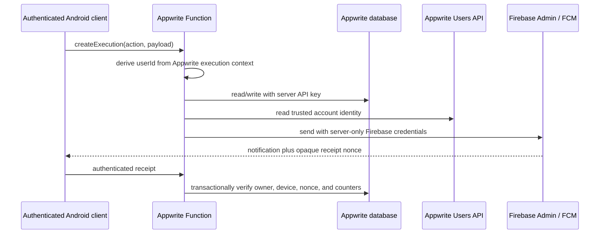
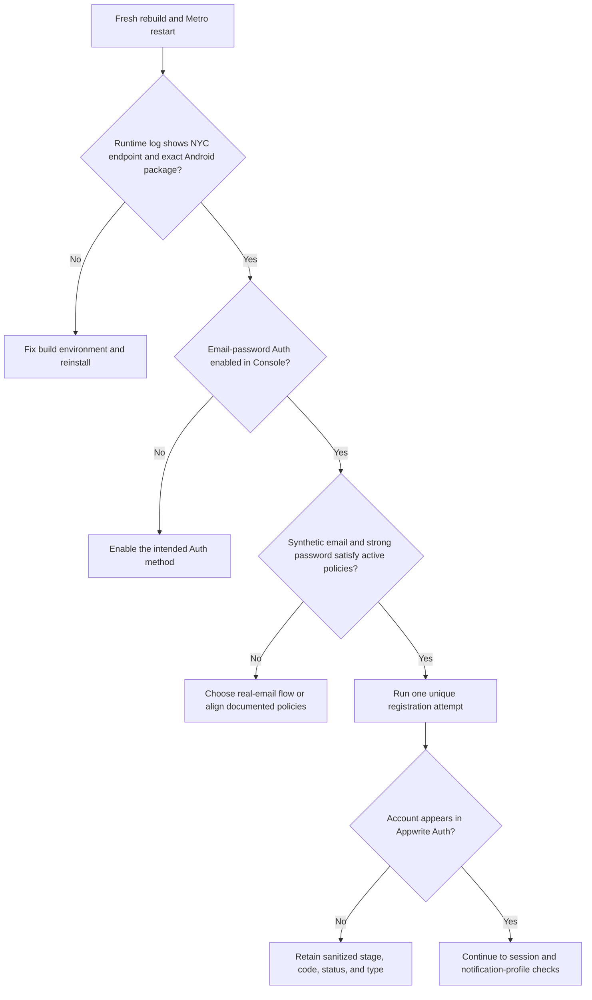

# Appwrite backend code review

Reviewed 2026-09-28 against the current working tree in `C:\Users\ricky\REPOS\PushNotification_ExampleRepo`. This review covers the two active Appwrite Functions, their shared server code, the React Native Appwrite integration, the packaging and deployment checks, and the repository’s database/permission guidance. It deliberately distinguishes local evidence from facts that require the Appwrite Console or a live device.

## Executive assessment

The backend has a substantially better security shape than a typical notification prototype. The mobile client does not receive the Appwrite API key or Firebase Admin credentials. Device ownership comes from Appwrite’s authenticated execution context rather than a client-supplied `userId`. New profile and token documents are read-only to their owners, receipt nonces are stored as token-bound hashes, repeated receipts are idempotent, and transaction retries protect the counters and related state changes. The two-function boundary is also consistently enforced by the root workspace and archive scripts.

That good foundation does not make the repository deployable as-is. One tracked document contains a non-placeholder Appwrite API key, so credential rotation is the immediate release blocker. The fanout worker also has an availability failure in which one dangling device record can abort an otherwise valid broadcast and leave its job in `processing`. Finally, the remote Appwrite resources are described in Markdown rather than captured in an executable project configuration, while the packaging step resolves a fresh transitive dependency graph on every run. Those last two issues make a deployment harder to reproduce and harder to audit than the source code suggests.

The intended trust boundary is sensible:

## [P0] A server API key is committed in repository history

`Project_details/appwrite_function_environment.md:15` contains an `APPWRITE_API_KEY` assignment whose value is 265 characters long and is not marked as a placeholder. The file is tracked, clean in the current working tree, and appears in commit `cfe04b3`. I intentionally did not reproduce the value in this report and did not attempt to authenticate with it. Whether it still works is immaterial to the response: a server key committed to Git must be treated as compromised.

This key can bypass the document permissions that protect client users, within whatever scopes were granted to it. Because both active Functions depend on `APPWRITE_API_KEY`, leaving the credential in history undermines the otherwise correct server/client boundary in [`functions/_shared/appwrite.ts`](../../../functions/_shared/appwrite.ts).

Revoke the exposed key in Appwrite first and create a replacement with only the runtime scopes documented in [`DOCS/db_struct_notification_deployment.md`](../../db_struct_notification_deployment.md). Update both active Functions through Appwrite’s secret/environment-variable controls, never through Expo public variables. Replace the tracked value with an unmistakable placeholder, then purge the secret from reachable Git history using the repository owner’s chosen history-rewrite procedure. Anyone who may have cloned the old history should be told to discard or clean it. Rotation must happen before history cleanup, because deleting text from the latest commit does not invalidate a copied credential.

Acceptance is concrete: the old key fails, both Functions use the new least-privilege key, the repository and reachable history no longer contain the old value, and an authenticated remote smoke test still succeeds.

## [P2] One orphaned token can abort a whole fanout job

The fanout worker looks up every token owner through `users.get(token.userId)` and caches the resulting promise in [`functions/notification-fanout/src/main.ts:39`](../../../functions/notification-fanout/src/main.ts#L39). At line 44, a missing or temporarily unavailable Appwrite Auth user rejects that promise. The rejection escapes the worker; lines 52–53 then throw before the job’s final status and counts are written at lines 54–57.

This matters because database cleanup and Auth-account deletion are not atomic across services. A single dangling `device_tokens` row is enough to stop one worker. Tokens that the other workers already processed may have received FCM messages, while unclaimed tokens assigned to the failed worker are skipped. The job remains `processing` until a later replay retires it as stale, so the caller gets neither an accurate partial result nor a completed record. The existing test double always resolves `users.get`, leaving this failure path uncovered.

The robust fix is to isolate account lookup per token. A 404 should deactivate or skip that stale token and record a rejected recipient without aborting unrelated recipients. A transient Users API failure should be classified separately; either record that target as an error and let the job finish `partially_completed`, or fail the job through an explicit finalization path that preserves the counts already known. The display name is metadata, not a reason to lose the dispatch state machine, so a trusted profile name or a neutral fallback is preferable to a job-wide throw. Add a regression test containing two valid tokens and one token whose account lookup returns 404; the valid targets should still be attempted and the job should leave `processing` with internally consistent totals.

## [P2] The remote Appwrite backend is documented, but not reproducibly declared

There is no `appwrite.config.json` or equivalent checked-in provisioning program for the current project. The security-critical state—function execute access, runtime scopes, collection document security, attributes, indexes, and the two active deployments—exists only as Console instructions and Markdown. The repository’s own [`scripts/check-deployment.cjs:48`](../../../scripts/check-deployment.cjs#L48) accurately reports all of those items as `UNVERIFIED`, and [`DOCS/db_struct_notification_deployment.md:3`](../../db_struct_notification_deployment.md#L3) explicitly warns that writing the document does not apply the changes.

This is not merely a documentation preference. The source assumes a unique `notification_jobs.rateLimitKey` index, document-level read-only ownership, transaction support, and particular runtime scopes. If any one of those drifts in the Console, the same source can become unavailable or insecure. `assertJobSchema()` checks only the rate-limit attribute and index; it does not prove the rest of the permission model. The three retired standalone Function directories also remain tracked beside the two active roots, increasing the chance that a manual deployment follows an obsolete four-function document even though the packaging allowlist is correct.

Capture the non-secret remote definition in Appwrite CLI configuration, preferably with `includes` for the two Functions and database resources, or in a dedicated idempotent provisioning/inspection script if the current CLI cannot express a required setting. Keep secrets in remote Function variables, not in the config. Add a read-only drift check that verifies the exact two active Function IDs, authenticated execute access, runtime scopes, attributes, indexes, row/document security, and absence of client write grants. Retired source can remain for historical reference only if it is moved out of deployable-looking roots and clearly labeled; otherwise remove it in a separate, reviewed cleanup.

Until that remote check is run, this review cannot claim that the deployed backend enforces the permissions described by the repository.

## [P2] Function archives are not built from a stable transitive lock graph

[`scripts/package-functions.cjs:40`](../../../scripts/package-functions.cjs#L40) creates a fresh temporary directory, writes only exact direct dependency versions, and runs `npm install --package-lock-only` there. That produces a lockfile inside each archive, but it resolves transitive packages again at packaging time. Two builds from the same Git commit can therefore contain different transitive versions as registry metadata and dependency ranges change. Because the generated lockfiles live only in ignored archives, their changes are not reviewed in Git.

The current function-only audit reports two moderate findings through `gaxios` and its nested `uuid`; the advisory affects `uuid` versions below 11.1.1. No critical or high backend-function vulnerability was reported in this run. The wider mobile/runtime tree reports additional issues, but those are outside the two Function archives and should not be conflated with server exposure.

Make the archive dependency graph an input rather than an output. A practical approach is to maintain and review a lockfile dedicated to each independently installable Function package, then use `npm ci` while staging. If the workspace layout must retain one root lock, derive the staged install from that committed lock and fail when resolution would change it. Add an archive SBOM or at least dependency and checksum output to CI, and decide the Firebase Admin upgrade path that removes the vulnerable nested version without forcing an untested Expo migration. The isolated import smoke test should remain; it is valuable, but it verifies loadability and unauthenticated rejection rather than dependency provenance.

## [P1] The tested registration runtime is not proven to match the repaired source or the live Auth policy

This finding was added after device testing reported that an Appwrite Auth account was not created. The failure occurs before notification profile creation, database writes, Firebase registration, or either Appwrite Function. In the current flow, [`lib/appwrite/auth.ts:142`](../../../lib/appwrite/auth.ts#L142) calls the client Account API directly; only after that succeeds does the app create a session and later invoke `notification-support.ensureProfile`. The exposed server key and the notification Function findings above are serious, but they cannot explain an Auth account that never appears.

The repository now contains the correct NYC endpoint, project ID, Android platform call, early URL polyfill, and positional method signature required by the installed `react-native-appwrite@0.7.4`. A read-only `GET /account` probe reached the configured NYC project and returned the expected guest authorization error. A deliberately non-mutating registration probe used the same project/platform headers, the synthetic `diagnostic@push.local` address, and an intentionally invalid five-character password; Appwrite reached password validation and returned `400 general_argument_invalid` for the password. This proves current host-side routing, project selection, platform header acceptance, and basic `@push.local` email parsing. It does not prove that a valid registration passes the project’s Auth method, email policies, password dictionary, personal-data rule, or rate limit.

The strongest local mismatch is temporal. The only generated debug APK at `android/app/build/outputs/apk/debug/app-debug.apk` is timestamped 2026-09-25 23:24:58. The `.env` endpoint correction is timestamped 2026-09-26 00:11:36. That APK predates the regional fix. A debug build may load JavaScript from Metro rather than embedding a release bundle, but a Metro process or installed artifact started before the public-variable change can still execute the former `https://cloud.appwrite.io/v1` value. That endpoint was previously observed returning `general_access_forbidden` for this NYC project. The existing APK is therefore not acceptable evidence for the corrected registration path; restart Metro without stale environment state, rebuild, reinstall, and capture the runtime endpoint log before testing again.

The second gap is the Auth contract itself. [`lib/appwrite/auth.ts:105`](../../../lib/appwrite/auth.ts#L105) converts a username to a synthetic `username@push.local` address, while [`Code Review Jr Checklists/09-auth-policy.md:9`](../../../Code%20Review%20Jr%20Checklists/09-auth-policy.md#L9) still records the decision between synthetic aliases and real email as unfinished. Appwrite can independently disable email/password registration or reject signups through email policies, the password dictionary, password history, or the personal-data rule. The client checks only length. The unit tests use mocked success with `password123`; they do not exercise any rejected `account.create()` response or a live project policy. A common or username-derived test password can therefore pass the UI’s eight-character check and still be rejected by Appwrite.

Finally, [`lib/appwrite/authErrors.ts:44`](../../../lib/appwrite/authErrors.ts#L44) maps every numeric `409` to “already registered” and lines 47–52 map broad `401` results to “username or password is incorrect.” All unrecognized creation failures collapse to the generic registration message at lines 78–80. The development log retains `stage`, `code`, `status`, and `type`, which is safe and useful, but the failed test did not leave that evidence in the repository. Without the exact Appwrite `type` from the `creating-account` stage or a Console event, the files alone cannot distinguish disabled email/password Auth, an email-policy rejection, a password-policy rejection, rate limiting, an old regional endpoint in the installed runtime, or a genuine duplicate account.

The correction path should proceed without creating speculative test users. First rebuild and reinstall after restarting Metro, and verify the runtime log reports `https://nyc.cloud.appwrite.io/v1` and `com.pushnotificationexample.app`. In Appwrite Console, confirm that the `email-password` Auth method is enabled and record the active email and password policies. Decide and document whether this demo intentionally uses synthetic aliases; if the project enables public-domain email policies, collect a real email address instead. Then perform one registration with a unique username and a strong password that does not contain the username and is not a dictionary password, retaining only the sanitized error tuple if it fails. Expand the error mapper and unit tests for the actual Appwrite response types observed rather than guessing them.

## Authentication integration note

The current uncommitted authentication changes follow the `myapp` reference’s useful separation between a valid Appwrite session and optional notification-profile provisioning. They also bound user-facing waits and avoid blindly repeating a timed-out session mutation. Registration timeouts remain deliberately classified as uncertain: the UI tells the user not to resubmit immediately and to try sign-in, which is safer than issuing a second `account.create()`. This area passed its focused tests. It still needs physical-device proof against the registered Android platform and the live regional endpoint; local mocks cannot establish that a session is persisted correctly on the device.

## Verification performed

The local checks passed on 2026-09-28. `npm run typecheck` and both Function workspace checks exited successfully. Jest passed 7 suites and 57 tests. `npm run functions:package` generated exactly the two intended archives, and `npm run functions:smoke` installed each archive in isolation, loaded its compiled entry point, and confirmed a controlled unauthenticated `401 AUTH_REQUIRED` response. `npm run deployment:check` passed the local NYC endpoint, public IDs, Firebase Android file identity, and native Android application ID checks.

The production dependency audit for the two Function workspaces returned two moderate findings and no high or critical findings. The broader root production audit returned 18 findings—16 moderate and 2 high—mostly through the Expo toolchain; those should be handled as a separate mobile dependency review rather than used to describe the deployed Function archive inaccurately.

The following remain unverified because this was a source review, not an authorized live mutation or a physical-device acceptance run: the exact runtime bundle used in the failed registration test, Appwrite email/password and security-policy settings, the sanitized error tuple from that attempt, live Function deployments, execute permissions, environment variables, API-key scopes, collection permissions, indexes, transaction behavior on the actual project, Firebase delivery, receipt processing from foreground/background/terminated states, and two-device fanout. Passing local tests does not close those gates.

## Release conclusion

The implementation is not ready for a trusted deployment until the exposed Appwrite key is rotated. Independently, registration cannot be declared fixed until it succeeds from a fresh build and the runtime configuration plus live Auth policy are captured. After those blockers, the fanout orphan-account failure should be repaired before treating job status as reliable. Capturing the remote Appwrite state in executable configuration and stabilizing the Function lock graph are the next steps that turn a locally strong prototype into a backend that can be reproduced, audited, and recovered with confidence.
